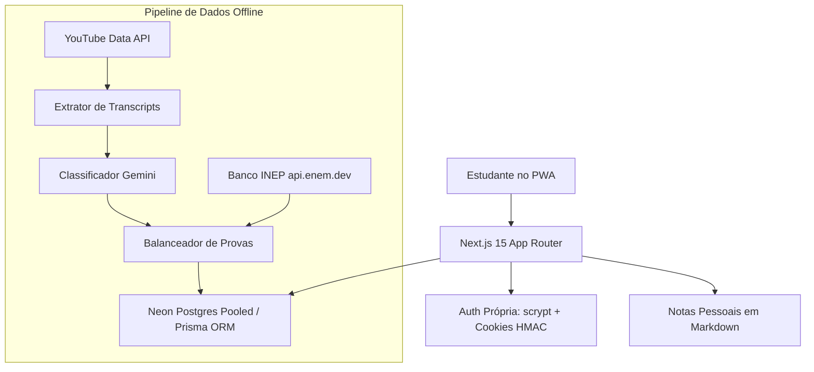

# Enemza — PWA de Estudos para o ENEM

<div align="center">

[](https://nextjs.org)
[](https://react.dev)
[](https://www.typescriptlang.org)
[](https://neon.tech)
[](https://www.prisma.io)
[](https://web.dev/progressive-web-apps/)
[](https://vitest.dev)

<p align="center">
  <strong>Plataforma PWA moderna, sem paywalls abusivos ou rankings punitivos</strong><br>
  Videoaulas curadas do YouTube, banco de questões do INEP + IA com dupla checagem e progresso por XP.
</p>

</div>

---

## 🎯 Motivo da Criação

A preparação para o ENEM no Brasil é dominada por cursinhos tradicionais caros e plataformas digitais repletas de distrações, rankings de notas que geram ansiedade patológica e interfaces lentas.

O **Enemza** foi projetado com uma tese central:
- **Acesso direto ao que importa**: o melhor conteúdo didático já está no YouTube de forma gratuita, mas disperso e desorganizado.
- **Ambiente de foco absoluto**: interface limpa, sem feeds infinitos ou competições tóxicas entre alunos.
- **Validação de aprendizado com rigor**: fixação imediata após assistir a cada módulo por meio de simulados objetivos com feedback detalhado.

---

## 💡 O que Soluciona

| Problema Tradicional | Solução do Enemza |
| :--- | :--- |
| **Dispersão de conteúdo no YouTube** | Aulas curadas dos melhores professores, organizadas didaticamente em 11 módulos do ENEM. |
| **Escassez de questões por subtópico** | Pipeline automatizado que une o banco oficial do INEP com questões geradas por LLM (com dupla validação obrigatória). |
| **Ansiedade de rankings globais** | Gamificação orientada a evolução pessoal (XP, streak de estudos e níveis), sem tabelas públicas comparativas. |
| **Acessibilidade em redes móveis instáveis** | Arquitetura PWA com capacidade offline-first, cadernos de notas em Markdown e caching eficiente. |

---

## 🏗️ Arquitetura & Decisões Registradas (ADRs)

Todas as decisões arquiteturais do projeto foram registradas em Architecture Decision Records (ADRs) antes de qualquer código ser escrito (disponíveis em `.harness/adr/`):



1. **Autenticação Proprietária Resiliente (ADR-001)**:
   - Implementação de hashing com `scrypt` e cookies de sessão criptografados via HMAC (`crypto`), eliminando custos por usuário de provedores externos como Auth0/Clerk.
2. **Neon Serverless PostgreSQL**:
   - Conexão em tempo de execução via pooler (`-pooler`) para escalar com zero consumo em momentos ociosos, e endpoint direto dedicado a migrações com Prisma.
3. **Pipeline de Conteúdo em Lote Offline (ADR-003)**:
   - O enriquecimento de dados e a geração de questões rodam de forma assíncrona via scripts CLI (`pipeline:*`), com tolerância a falhas e retomada (`resumable`), garantindo que requisições de usuários nunca dependam de chamadas síncronas a APIs de IA.
4. **Checkout e Webhook Transacional (ADR-002)**:
   - Processamento de compra via Kiwify com validação de payload criptográfico e emissão de e-mails transacionais assíncronos.

---

## 🛠️ Stack Tecnológica

- **Framework**: Next.js 15 (App Router, Server Actions, Turbopack).
- **Linguagem**: TypeScript com tipagem estrita de ponta a ponta.
- **Banco de Dados & ORM**: PostgreSQL Serverless (Neon) + Prisma ORM.
- **Mobile & Offline**: Progressive Web App (PWA) via Serwist.
- **Inteligência Artificial**: Google Gemini API (para classificação pedagógica e geração de questões complementares).
- **Testes**: Vitest com suporte a containers efêmeros de teste via Testcontainers.

---

## 🚀 Setup & Execução Local

```bash
# 1. Clone o projeto
git clone https://github.com/GabrielArantesSilva/EnemzaMVP.git
cd EnemzaMVP

# 2. Instale as dependências
pnpm install

# 3. Configure as variáveis de ambiente
cp .env.example .env
# Preencha DATABASE_URL, DIRECT_URL e SESSION_SECRET no seu .env

# 4. Gere os clientes do Prisma e aplique as migrações
pnpm prisma:generate
pnpm prisma:migrate

# 5. Popule com as fixtures iniciais
pnpm exec tsx prisma/seed.ts

# 6. Execute em modo de desenvolvimento
pnpm dev
# Acesse: http://localhost:3000
```

---

## 🧪 Comandos Úteis

| Script | Descrição |
| :--- | :--- |
| `pnpm dev` | Inicia o servidor local com Next.js Turbopack |
| `pnpm build` | Compila o build de produção |
| `pnpm test` | Executa a suíte de testes automatizados com Vitest |
| `pnpm typecheck` | Validação estática de tipos via `tsc --noEmit` |
| `pnpm prisma:studio` | Interface gráfica para inspeção do banco de dados |

---

## 👨‍💻 Autor

- **Gabriel Arantes Silva** — Engenheiro Full Stack
- **Portfólio:** [https://gabrielarantessilva.com](https://gabrielarantessilva.com)
